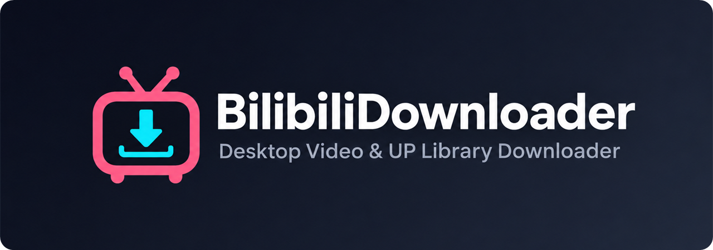

<p align="center">
  
</p>

**English** | [简体中文](README.zh-CN.md)

# BilibiliDownloader

[](#requirements)
[](#requirements)
[](LICENSE)

A cross-platform desktop application (Java / Swing) for parsing and downloading Bilibili media: single and multi-part videos, **an UP's entire public upload history**, seasons and series, courses, favorites, Watch Later, audio tracks, and article/opus images.

## Relationship with Upstream

This repository is a fork of [nICEnnnnnnnLee/BilibiliDown](https://github.com/nICEnnnnnnnLee/BilibiliDown) (based on `v6.40`, licensed under Apache-2.0). It keeps the upstream parsing and downloading core while adding the following improvements:

- **Redesigned Swing UI** (`Theme`, `FlatTabbedPaneUI`, `FlatComboBoxUI`): Card-based layout, unified CJK font selection, flat tabs and dropdowns, Home-tab page-size selector (`10 / 20 / 30 / 40 / 60`), middle-click or double-click tab closing, and an optional subtle custom wallpaper (`config/background.png` or `config/background.jpg`).
- **UP All Uploads Tab** (`TabUpAll` + `UpAllListFetcher`): Click **「UP 全部视频」** on the Home tab to load up to 10,000 public uploads (`200` pages × `50` items) into a sortable `JTable`, filter by publish year without losing checked rows, and queue selected videos in one batch.
- **Rate-Limit Pacing & Checkpointed Resume**: Enforces at least `300 ms` (or `bilibili.download.period.between.query`) between page requests, retries risk-control errors (`-799`, `-352`, `-412`, `-509`, HTTP `412`) with `1s / 2s / 3s` backoff, falls back to the non-WBI endpoint (`x/space/arc/search`), preserves fetched pages when interrupted, and resumes from the failed page via **「继续加载」**.
- **Force `arc/search` Query Parameter** (`URL4UPAllFullParser`): Appending `?full=1` (`full=true` or `full=all`) to an UP space URL forces paginated `x/space/wbi/arc/search` parsing (`50` items per API page).
- **Automatic Quality Fallback** (`bilibili.download.quality.autoFallback`, default `true`): Automatically selects the highest available stream and logs the reason when the requested quality is unavailable (for example, unauthenticated or non-VIP accounts) instead of aborting with an error dialog.
- **Login & Launcher Improvements**: QR login writes a fallback image to `config/qr-login.png` alongside the popup window; Windows `.bat` launchers automatically detect bundled JREs (`minimal-bilibilidown-jre/`, `runtime/`), `JAVA_HOME`, or `PATH`, and work with either `launch.jar` or `INeedBiliAV.jar`.

See [UPDATE.md](UPDATE.md) for the full fork summary and upstream version history.

## Screenshots

| Home (`主页`) | UP All Uploads (`UP 视频列表`) |
| :---: | :---: |
|  |  |
| **Video Details (`视频`)** | **Download Queue (`下载页`)** |
|  |  |

## Supported Inputs

- **Videos & Short Links**: `BV...`, `av...`, standard `bilibili.com/video/...` URLs, `https://b23.tv/...` short links, and interactive videos.
- **UP Uploads**:
  - Bare numeric `mid` (`3+` digits, e.g. `39597640`) or `https://space.bilibili.com/<mid>` with **「UP 全部视频」** (opens the full table view).
  - Space upload URLs (`space.bilibili.com/<mid>`, `/video`, `/upload/video`, `/search/video?keyword=...`, or `/video?full=1`) with **「查找」** (opens paginated `TabVideo`).
- **Seasons, Series & Channels**:
  - Seasons / collections: `space.bilibili.com/<mid>/lists/<sid>?type=season`, `/favlist?...fid=<sid>...ftype=collect`, `/channel/collectiondetail?sid=<sid>`.
  - Series: `space.bilibili.com/<mid>/lists/<sid>?type=series`, `www.bilibili.com/list/<mid>/?sid=<sid>`, `/channel/seriesdetail?sid=<sid>`.
  - Legacy channels: `space.bilibili.com/<mid>/channel/detail?cid=<cid>`.
- **Favorites & Watch Later**: `ml<id>`, `space.bilibili.com/<mid>/favlist?fid=<id>`, and `www.bilibili.com/watchlater/#/list` (also available from the **收藏夹** dropdown after login).
- **Courses (PUGV)**: `www.bilibili.com/cheese/play/ss<id>` and `www.bilibili.com/cheese/play/ep<id>`.
- **Audio**: `au<id>`, playlists `am<id>`, and created collections `www.bilibili.com/audio/mycollection/<id>` (requires login).
- **Images, Articles & Opus**: `h<id>` / `h.bilibili.com/<id>`, articles `bilibili.com/read/cv<id>`, readlists `bilibili.com/read/readlist/rl<id>`, dynamic posts `bilibili.com/opus/<id>` / `t.bilibili.com/<id>`, and saved opus/albums `space.bilibili.com/<mid>/favlist?fid=opus` (or `fid=albumfav`, requires login).

> **Note on Bangumi (`ep` / `ss` / `md`)**: Upstream disabled standalone `EPParser`, `SSParser`, and `MdParser` annotations (`//@Bilibili`) in v5.9. Videos accessed via `BV` / `av` IDs that redirect to PGC playback still query `pgc/player/web/playurl`, and custom `.java` parsers placed in `parsers/` are compiled and loaded at startup.

## Requirements

- **Java 8 or newer**: JRE 8+ to run; JDK 8+ to build from source (release bytecode targets Java `1.8`).
- **FFmpeg**: Required for muxing DASH `.m4s` video/audio into `.mp4` and converting audio-only streams.
  - Windows users get a prebuilt binary out of the box at `release/ffmpeg.exe`.
  - On `win_amd64`, `win_arm64`, `linux_amd64`, and `linux_arm64`, if `ffmpeg` is not found at `bilibili.ffmpegPath` or on system `PATH`, the app offers to download a minimal build at startup. On macOS, install `ffmpeg` via Homebrew (`brew install ffmpeg`) or set `bilibili.ffmpegPath` in `config/app.config`.

## Quick Start

1. Clone or download this repository.
2. Launch the app from `release/`:
   - **Windows**: Double-click `release/Double-Click-to-Run-for-Win.bat`. To keep the console window open for troubleshooting logs, run `release/Double-Click-to-Run-for-Win-debug.bat`.
   - **macOS / Linux**: Run `INeedBiliAV.jar` directly from a terminal:
     ```bash
     cd release
     java -Dfile.encoding=utf-8 -Dhttps.protocols=TLSv1.2 -jar INeedBiliAV.jar
     ```
     *(Note: `Double-Click-to-Run-for-Mac.command` and `Create-Shortcut-on-Desktop-for-Linux.sh` invoke `launch.jar`, which is only present in packaged CI archives or after running `.github/scripts/package_launcher.sh` and copying `launch.jar` into `release/`.)*
3. Paste a URL or ID into **链接或 ID** and press **Enter** (or click **查找**).

## Usage

### 1. Single / Multi-Part Videos, Subtitles & Danmaku

Paste a video link or `BV` ID and press **Enter**:
- Click any quality button (`8K`, `HDR`, `4K`, `1080P60`, `1080P+`, `1080P`, `720P60`, `720P`, `480P`, `320P`) on a clip card to download that part, or click **弹幕** (`.ass`) / **字幕** (`.srt`) for danmaku and CC subtitles.
- Use **优先清晰度** + **批量下载** in the top-right corner to download every part in the current tab, or **字幕下载** to download CC subtitles for all parts.
- Click the title, BV ID, brief, or cover preview to copy its text/URL to the clipboard; double-click a clip title to copy `Title + BV`; hold a clip title for `0.5s` to preview that part's cover.

### 2. Download All Uploads of an UP (`UP 全部视频`)

1. Enter `https://space.bilibili.com/39597640` or `39597640` on the Home tab.
2. Click **「UP 全部视频」** to open the **UP 视频列表** tab.
3. Wait for pagination to finish. If Bilibili triggers rate limiting (`-799` / `-352` / `HTTP 412`), already-loaded videos remain in the table—wait a moment (or log in first) and click **「继续加载」** to resume from the interrupted page.
4. Filter by **年份** (Year), sort by clicking column headers (`标题`, `发布日期`, `BV号`), use **全选** / **清空** on the current filter view, pick **清晰度**, and click **「下载所选」**.

For a detailed Chinese guide covering all three UP batch methods (`UP 全部视频`, `?full=1`, and `batchDownload.config`), see [USAGE_UP_ALL.md](USAGE_UP_ALL.md).

### 3. Config-Driven & Scheduled Batch Download (`batchDownload.config`)

Create `config/batchDownload.config` inside the active base directory (`release/config/batchDownload.config` when running from `release/`), select it under **配置 → 一键下载配置**, and click **操作 → 一键下载** (or **操作 → 按计划周期下载** for scheduled polling):

```ini
[url:https://space.bilibili.com/39597640/video]
start.page = 1
stop.condition = page:10
download.condition = _!downloaded
```

- Supported section headers: `[url:<link>]`, `[favorite:all]`, `[favorite:FolderA,FolderB]`.
- Supported condition keys: `_` (`_:_` match all, `_!downloaded` skip recorded downloads), `page` (`:`, `>`, `<`), `bv` (`:`), `favTime` (`>`, `<` with `yyyy-MM-dd`), `cTime` (`>`, `<` with `yyyy-MM-dd`), `avTitle` (`:`, `!` Java regex), `clipTitle` (`:`, `!` Java regex).
- Comma-separated expressions on one line are **AND**-ed; multiple `download.condition` / `stop.condition` lines are **OR**-ed.

### 4. Account Login & Cookie Refresh

Click the avatar on the Home tab or open **操作 → 登录相关**:
- **QR Code Login (`二维码登录`, default)**: Opens a QR code window and also writes `config/qr-login.png` as a fallback image. Scan with the Bilibili mobile app within 60 seconds.
- **Password / SMS Login (`用户名密码登录` / `短信验证登录`)**: Starts a local loopback HTTP server (`127.0.0.1:8787`, configurable via `bilibili.server.port`) and opens your browser to complete the Geetest captcha. SMS phone numbers must include country code and a space (e.g. `+86 18812344321`).
- **Credentials & Refresh**: Cookies and `refresh_token` are saved locally in `config/cookies.config`. Use **操作 → 登录相关 → 刷新Cookie** (or set `bilibili.login.cookie.tryRefreshOnStartup = true`) to refresh cookies and upload browser fingerprint parameters when encountering `-352` / `412` risk checks.

## Configuration

At startup, settings are loaded in order: built-in `/resources/app.config` → `{baseDir}/config/app.config` → `{baseDir}/config/user.config` (deleted after read when `bilibili.user.delete = true`). You can edit `config/app.config` directly or use **配置 → 打开配置页** (click **保存** and restart, or click **操作 → 重新加载配置** for runtime-reloadable options).

| Key | Default (`app.config`) | Description |
| --- | --- | --- |
| `bilibili.savePath` | `download/` | Output directory (relative to base directory or absolute path). |
| `bilibili.name.format` | `(:listName 0_listName\)UpName\avTitle-(:favTime favTime-)pAv2-qn` | Output filename/subfolder template. |
| `bilibili.name.doAfterComplete` | `true` | Rename immediately after download (`false` appends to `download/rename.bat`). |
| `bilibili.name.autoNumber` | `true` | Append `(01)`, `(02)`... when a file with the same name already exists. |
| `bilibili.format` | `0` | `0`: DASH `.m4s` merged to `.mp4`; `1`: `.flv`; `2`: direct single-stream `.mp4`. |
| `bilibili.dash.download.mode` | `0` | `0`: video + audio; `1`: video only; `2`: audio only (see `bilibili.dash.suffix4AudioOnly`). |
| `bilibili.dash.video.codec.priority` | `12, 7, 13` | Codec priority: `12` HEVC, `7` AVC (H.264), `13` AV1, `-1` first returned. |
| `bilibili.menu.download.qn` | `1080P` | Preferred quality for menu / `UP 全部视频` / batch downloads (`8K` down to `320P`, `CC字幕`, `弹幕`). |
| `bilibili.tab.download.qn` | `1080P` | Default preferred quality in `TabVideo`. |
| `bilibili.download.quality.autoFallback` | `true` | Fall back to best available quality instead of throwing `QualityTooLowException`. |
| `bilibili.info.query.strategy` | `returnFixedValue` | Quality list strategy: `returnFixedValue` (0 extra requests), `tryNormalTypeFirst`, `judgeTypeFirst`. |
| `bilibili.pageSize` | `20` | Items per page for paginated parsers. |
| `bilibili.download.poolSize` | `3` | Concurrent download worker threads. |
| `bilibili.download.period.between.query` | `0` | Delay in ms after each link/list query (set to `500`–`1500` to reduce rate limits). |
| `bilibili.ffmpegPath` | `ffmpeg` | Path to `ffmpeg` executable (resolved relative to base directory first, then `PATH`). |
| `bilibili.repo` | `on` | Skip tasks already recorded in `config/repo.config` (`on` / `off`). |
| `bilibili.user.login` | `qr` | Default login method when clicking avatar: `qr`, `pwd`, or `sms`. |

### Useful JVM Properties

- `-Dbilibili.prop.dataDirPath=/path/to/writable/dir`: Store `config/` and relative `download/` in a custom writable directory (useful when installed under read-only system directories).
- `-Dbilibili.prop.log=false`: Disable verbose console log output.
- `-Dbilibili.prop.mainClass=nicelee.ui.FrameMain_v3_4`: Use the legacy main frame class (requires launching via `launch.jar`).

More answers and troubleshooting tips are documented in [release/wiki/Q&A.md](release/wiki/Q&A.md).

## Build from Source

The project uses standard `javac` and `jar` with vendored JARs in `libs/` (no Maven or Gradle required). Use JDK 8 if you want strict Java 8 bytecode compatibility:

```bash
# Linux / macOS
./package.sh                            # builds INeedBiliAV.jar (main: nicelee.ui.FrameMain)
./.github/scripts/package_launcher.sh   # optional: builds launch.jar (main: nicelee.memory.App)
cp INeedBiliAV.jar release/
```

```bat
:: Windows
package.bat
copy /Y INeedBiliAV.jar release\
```

`launch.jar` loads `INeedBiliAV.jar` entirely into memory via `MemoryClassLoader` so the core JAR file is not locked on Windows during self-updates.

## Project Structure

```text
src/                 Core application source (parsers, downloaders, local captcha/cookie server, Swing UI)
src-launcher/        In-memory JAR launcher source (builds launch.jar)
src/resources/       Built-in app.config template, icons, Geetest & cookie-refresh static pages
libs/                Bundled libraries (zxing core 3.3.3, javax.mail 1.6.2, JAF 1.1.1)
release/             Runnable distribution directory (INeedBiliAV.jar, scripts, ffmpeg.exe, wiki, previews)
config/              Development config directory used when running from repo root / IDE
.github/             GitHub Actions workflows, packaging scripts, and WiX/jpackage MSI builder
```

## Third-Party Components

- [JSON-java (org.json)](https://github.com/stleary/JSON-java) (MIT) — JSON parsing (`src/org/json/`)
- [ZXing](https://github.com/zxing/zxing) (Apache-2.0) — QR code generation (`libs/core-3.3.3.jar`)
- [JavaMail](https://javaee.github.io/javamail/) & JAF (CDDL / GPLv2+CE) — Email notification pusher (`libs/javax.mail-1.6.2.jar`, `libs/jaf-1.1.1-activation.jar`)
- [FFmpeg](https://ffmpeg.org/) (LGPL / GPL) — External binary for stream muxing and audio conversion
- [geetest-validator](https://github.com/kuresaru/geetest-validator) — Browser Geetest verification page (`src/resources/geetest-validator/`)
- AV/BV conversion adapted from [Colerar/abv](https://github.com/Colerar/abv) (MIT)
- Cookie refresh `correspond` RSA-OAEP reference from [SocialSisterYi/bilibili-API-collect#524](https://github.com/SocialSisterYi/bilibili-API-collect/issues/524)

## License & Disclaimer

Licensed under the [Apache License 2.0](LICENSE). Third-party license texts are included in `release/LICENSE/third-party/`.

This project is an independent tool and is not affiliated with or endorsed by Bilibili. Use it strictly for personal, non-commercial study and backup in compliance with applicable laws and Bilibili's Terms of Service. Respect content creators' copyrights and do not redistribute downloaded media.
