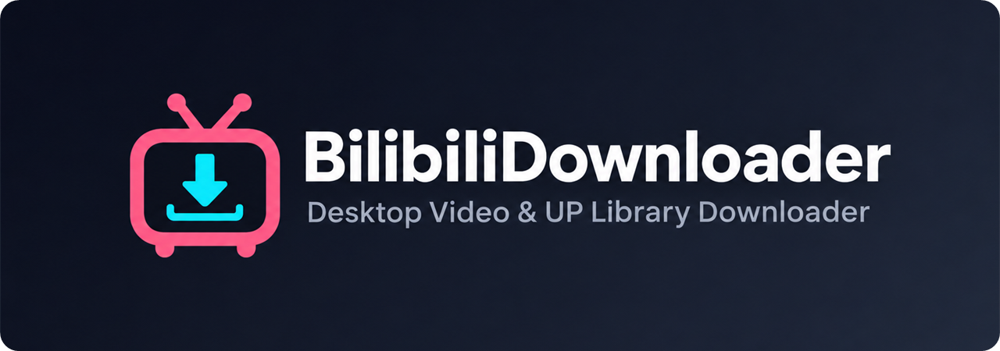

<p align="center">
  
</p>

[English](README.md) | **简体中文**

# BilibiliDownloader

[](#运行环境)
[](#运行环境)
[](LICENSE)

基于 Java / Swing 的跨平台桌面端 B 站媒体下载工具，支持单视频与多 P 视频、**指定 UP 主的全部公开投稿**、合集与系列列表、课程、收藏夹、稍后再看、音频歌单及专栏/动态图片解析下载。

## 与上游仓库的关系及本分支改动

本仓库 fork 自 [nICEnnnnnnnLee/BilibiliDown](https://github.com/nICEnnnnnnnLee/BilibiliDown)（基于上游 `v6.40`，沿用 Apache-2.0 协议）。在保留原有解析与下载引擎的基础上，本分支主要做了以下改进：

- **界面重设计**（`Theme`、`FlatTabbedPaneUI`、`FlatComboBoxUI`）：改为浅色圆角卡片布局，自动匹配系统中文字体，扁平化标签栏与下拉框；主页直接提供「每页数量」（`10 / 20 / 30 / 40 / 60`）切换；支持双击或鼠标中键关闭标签页；支持放入 `config/background.png` 或 `config/background.jpg` 叠加低透明度自定义背景。
- **「UP 全部视频」批量面板**（`TabUpAll` + `UpAllListFetcher`）：在主页输入 UP 空间链接或纯数字 `mid` 后点击 **「UP 全部视频」**，即可将最多 10,000 条公开投稿（`200` 页 × 每页 `50` 条）加载到 `JTable` 表格中，支持按标题/发布日期/BV 号排序、按年份筛选（切换年份不丢失已勾选项）及一键加入下载队列。
- **限流退避与断点续拉**：抓取投稿列表时自动控制翻页间隔（不少于 `300 ms`，并遵守 `bilibili.download.period.between.query`）；遇到 `-799`、`-352`、`-412`、`-509` 或 `HTTP 412` 等风控错误时按 `1s / 2s / 3s` 退避重试，并自动回退到非 WBI 旧接口 `x/space/arc/search` 再试一次；仍中断时保留已拉取列表，状态栏提示原因，并启用 **「继续加载」** 从中断页续拉去重。
- **`?full=1` 全量解析器**（`URL4UPAllFullParser`）：在空间链接后追加 `?full=1`（或 `full=true` / `full=all`）可强制走 `x/space/wbi/arc/search` 分页解析（接口单页上限 `50` 条）。
- **清晰度自动降级**（`bilibili.download.quality.autoFallback`，默认 `true`）：当所选清晰度不可用（如未登录或无大会员权限）时，默认自动采用实际返回的最高可用画质并在日志中说明，避免批量下载因画质异常中断。
- **扫码兜底与启动脚本整理**：二维码登录时除弹出扫码窗口外，同步输出 `config/qr-login.png` 兜底图片；Windows 启动脚本自动按优先级查找随包精简 JRE、`runtime/`、`JAVA_HOME` 与系统 `PATH`，并兼容 `launch.jar` 与 `INeedBiliAV.jar`。

完整改动说明与上游历史记录见 [UPDATE.md](UPDATE.md)。

## 界面预览

| 主页 | UP 全部视频 |
| :---: | :---: |
|  |  |
| **视频详情页** | **下载页** |
|  |  |

## 支持的输入类型

- **视频与短链**：`BV` 号、`av` 号、标准视频页链接、`https://b23.tv/...` 短链接、互动视频。
- **UP 主投稿**：
  - 纯数字 `mid`（3 位及以上，如 `39597640`）或 `https://space.bilibili.com/<mid>` 配合 **「UP 全部视频」** 按钮（打开完整表格页）。
  - 空间视频链接（`space.bilibili.com/<mid>`、`/video`、`/upload/video`、`/search/video?keyword=...`、`/video?full=1`）配合 **「查找」** 按钮（打开分页视频标签页）。
- **合集、系列与频道**：
  - 合集：`space.bilibili.com/<mid>/lists/<sid>?type=season`、`/favlist?...fid=<sid>...ftype=collect`、`/channel/collectiondetail?sid=<sid>`
  - 系列列表：`space.bilibili.com/<mid>/lists/<sid>?type=series`、`www.bilibili.com/list/<mid>/?sid=<sid>`、`/channel/seriesdetail?sid=<sid>`
  - 旧版频道：`space.bilibili.com/<mid>/channel/detail?cid=<cid>`
- **收藏夹与稍后再看**：`ml<id>`、`space.bilibili.com/<mid>/favlist?fid=<id>`、`www.bilibili.com/watchlater/#/list`（登录后可直接从主页 **收藏夹** 下拉框选择）。
- **课程（PUGV）**：`www.bilibili.com/cheese/play/ss<id>`、`www.bilibili.com/cheese/play/ep<id>`。
- **音频**：单曲 `au<id>`、歌单 `am<id>`、自建歌单 `www.bilibili.com/audio/mycollection/<id>`（需登录）。
- **图文、专栏与相簿**：相簿 `h<id>` / `h.bilibili.com/<id>`、专栏 `bilibili.com/read/cv<id>`、专栏文集 `bilibili.com/read/readlist/rl<id>`、图文动态 `bilibili.com/opus/<id>` / `t.bilibili.com/<id>`、个人图文收藏 `space.bilibili.com/<mid>/favlist?fid=opus`（或 `fid=albumfav`，需登录）。

> **关于番剧（`ep` / `ss` / `md`）**：上游自 v5.9 起默认注释了独立番剧解析器 `EPParser`、`SSParser`、`MdParser` 的 `@Bilibili` 注解；若输入含 PGC 重定向的 `BV` / `av` 号仍会调用 `pgc/player/web/playurl` 解析，也可在 `parsers/` 目录放置自定义 `.java` 解析器扩展。

## 运行环境

- **Java 8 及以上**：运行只需 JRE 8+；从源码编译需 JDK 8+（发布包目标字节码为 Java `1.8`）。
- **FFmpeg**：用于将 DASH 音视频分离流（`.m4s`）无损封装为 `.mp4`，或转换仅音频文件。
  - Windows 可直接使用仓库内置的 `release/ffmpeg.exe`。
  - 在 `win_amd64`、`win_arm64`、`linux_amd64`、`linux_arm64` 平台上，若 `bilibili.ffmpegPath` 和系统 `PATH` 中均未找到 `ffmpeg`，程序启动时会提示是否下载精简版 `ffmpeg`；macOS 用户请通过 `brew install ffmpeg` 安装或在配置中指定路径。

## 快速开始

1. 克隆或下载本仓库。
2. 进入 `release/` 目录启动程序：
   - **Windows**：双击 `release/Double-Click-to-Run-for-Win.bat`。若需要查看终端报错日志，双击 `release/Double-Click-to-Run-for-Win-debug.bat`。
   - **macOS / Linux**：在终端进入 `release/` 目录直接运行主 JAR：
     ```bash
     cd release
     java -Dfile.encoding=utf-8 -Dhttps.protocols=TLSv1.2 -jar INeedBiliAV.jar
     ```
     *（注：`Double-Click-to-Run-for-Mac.command` 与 `Create-Shortcut-on-Desktop-for-Linux.sh` 默认调用 `launch.jar`；从源码仓库直接运行时，若未执行 `.github/scripts/package_launcher.sh` 生成 `launch.jar`，请直接运行 `INeedBiliAV.jar`。）*
3. 在主页「链接或 ID」输入框粘贴地址或编号，按 **Enter** 或点击 **「查找」**。

## 使用说明

### 1. 单视频 / 多 P 视频 / 字幕与弹幕

粘贴视频链接或 `BV` 号回车后进入视频详情页：
- 点击左侧分 P 卡片上的清晰度按钮（`8K`、`HDR`、`4K`、`1080P60`、`1080P+`、`1080P`、`720P60`、`720P`、`480P`、`320P`）即可单独下载该 P，点击 **弹幕**（保存为 `.ass`）或 **字幕**（保存为 `.srt`）可下载对应附件。
- 右上角选择 **优先清晰度** 后点 **「批量下载」** 可下载当前标签页的全部分 P；点 **「字幕下载」** 可批量下载全部 CC 字幕。
- 单击标题、BV 号、简介或右侧封面可复制对应文本/图片链接；双击分 P 标题复制 `标题 + BV号`；长按分 P 标题 `0.5 秒` 以上可切换右侧预览图。

### 2. 下载指定 UP 主的全部视频

1. 在主页输入框粘贴 `https://space.bilibili.com/39597640` 或直接输入 `39597640`。
2. 点击 **「UP 全部视频」**，自动打开 **UP 视频列表** 标签页并分页拉取投稿。
3. 若状态栏提示触发风控（`-799` / `-352` / `412`），已加载的视频会完整保留；稍等片刻（或先登录账号）后点击 **「继续加载」** 即可从断点页继续。
4. 按 **年份** 筛选、点击表头排序、用 **全选** / **清空** 勾选目标视频，选好 **清晰度** 后点 **「下载所选」**。

三种批量抓 UP 投稿方式的完整图文说明（`UP 全部视频`、`?full=1`、`batchDownload.config`）见 [USAGE_UP_ALL.md](USAGE_UP_ALL.md)。

### 3. 配置文件一键下载与周期任务（`batchDownload.config`）

在当前数据目录新建 `config/batchDownload.config`（运行 `release/` 下程序时路径为 `release/config/batchDownload.config`），在菜单栏 **配置 → 一键下载配置** 中选中后，点击 **操作 → 一键下载**（单次）或 **操作 → 按计划周期下载**（定时轮询）：

```ini
[url:https://space.bilibili.com/39597640/video]
start.page = 1
stop.condition = page:10
download.condition = _!downloaded
```

- 支持区块头：`[url:<链接>]`、`[favorite:all]`、`[favorite:收藏夹1,收藏夹2]`。
- 支持判断字段：`_`（`_:_` 匹配全部，`_!downloaded` 跳过仓库中已记录视频）、`page`（`:`、`>`、`<`）、`bv`（`:`）、`favTime`（`>`、`<`，格式 `yyyy-MM-dd`）、`cTime`（`>`、`<`，格式 `yyyy-MM-dd`）、`avTitle`（`:`、`!` 正则表达式）、`clipTitle`（`:`、`!` 正则表达式）。
- 同一行用英文逗号分隔表示“且”，多行同名配置表示“或”。

### 4. 登录与 Cookie 刷新

点击主页左上角头像，或打开菜单 **操作 → 登录相关**：
- **二维码登录**（默认）：弹出二维码窗口，同时在 `config/qr-login.png` 生成图片兜底，使用手机 B 站客户端在 60 秒内扫码确认即可。
- **用户名密码 / 短信验证登录**：程序会在本地启动仅监听回环地址的临时服务（默认端口 `8787`，由 `bilibili.server.port` 控制）并调用浏览器完成极验验证码；短信登录手机号需按 `+国际区号 手机号` 格式填写（注意中间空格，例如 `+86 18812344321`）。
- **凭证保存与刷新**：登录成功后 Cookie 与 `refresh_token` 保存在 `config/cookies.config`。遇到风控时可点击 **操作 → 登录相关 → 刷新Cookie**（同时会上传浏览器指纹参数），也可设置 `bilibili.login.cookie.tryRefreshOnStartup = true` 在每次启动时按需静默刷新。

## 常用配置

程序启动时依次加载内置 `/resources/app.config` → `{数据目录}/config/app.config` → `{数据目录}/config/user.config`（`bilibili.user.delete = true` 时读取后自动删除 `user.config`）。可直接编辑 `config/app.config`，也可通过菜单 **配置 → 打开配置页** 筛选修改并保存（重启生效，部分运行期项可点 **操作 → 重新加载配置** 立即生效）。

| 配置项 | 默认值（`app.config`） | 说明 |
| --- | --- | --- |
| `bilibili.savePath` | `download/` | 下载保存目录（支持相对数据目录路径或绝对路径）。 |
| `bilibili.name.format` | `(:listName 0_listName\)UpName\avTitle-(:favTime favTime-)pAv2-qn` | 文件命名与子目录模板。 |
| `bilibili.name.doAfterComplete` | `true` | 下载完成后立即重命名；设为 `false` 则写入 `download/rename.bat`。 |
| `bilibili.name.autoNumber` | `true` | 目标文件重名时自动追加 `(01)`、`(02)` 序号。 |
| `bilibili.format` | `0` | `0`：DASH 音视频合并为 MP4；`1`：FLV；`2`：直接单文件 MP4（无法选清晰度）。 |
| `bilibili.dash.download.mode` | `0` | `0`：音视频合并；`1`：仅视频；`2`：仅音频（后缀由 `bilibili.dash.suffix4AudioOnly` 控制）。 |
| `bilibili.dash.video.codec.priority` | `12, 7, 13` | 视频编码优先级：`12` HEVC、`7` AVC(H.264)、`13` AV1、`-1` 任意。 |
| `bilibili.menu.download.qn` | `1080P` | 菜单栏、`UP 全部视频` 与一键下载的优先清晰度（支持 `8K`～`320P`、`CC字幕`、`弹幕`）。 |
| `bilibili.tab.download.qn` | `1080P` | 视频详情页默认的优先清晰度。 |
| `bilibili.download.quality.autoFallback` | `true` | 期望清晰度不可用时自动降级为最高可用清晰度，不抛异常中断。 |
| `bilibili.info.query.strategy` | `returnFixedValue` | 清晰度列表查询策略：`returnFixedValue`（零额外请求）、`tryNormalTypeFirst`、`judgeTypeFirst`。 |
| `bilibili.pageSize` | `20` | 分页解析时单页条数。 |
| `bilibili.download.poolSize` | `3` | 最大并发下载任务数。 |
| `bilibili.download.period.between.query` | `0` | 每次查询下载链接/列表后的等待毫秒数（频繁触发风控时建议设为 `500`～`1500`）。 |
| `bilibili.ffmpegPath` | `ffmpeg` | `ffmpeg` 可执行文件路径（优先相对数据目录解析，再查找系统 `PATH`）。 |
| `bilibili.repo` | `on` | 下载前先检查 `config/repo.config` 去重记录（`on` / `off`）。 |
| `bilibili.user.login` | `qr` | 点击头像时的默认登录方式：`qr`、`pwd`、`sms`。 |

### 常用 JVM 启动参数

- `-Dbilibili.prop.dataDirPath=/可写目录路径`：将 `config/` 及相对下载目录指到有写权限的目录（程序安装在系统只读目录时必配）。
- `-Dbilibili.prop.log=false`：减少控制台日志输出。
- `-Dbilibili.prop.mainClass=nicelee.ui.FrameMain_v3_4`：切换旧版主界面入口类（需通过 `launch.jar` 启动）。

更多排障与配置问答请查阅 [release/wiki/Q&A.md](release/wiki/Q&A.md)。

## 从源码构建

项目直接使用 `javac` + `jar` 配合 `libs/` 下的依赖包构建，不依赖 Maven 或 Gradle。如需保证 Java 8 运行兼容性，请使用 JDK 8 编译：

```bash
# Linux / macOS
./package.sh                            # 生成主程序 INeedBiliAV.jar（入口 nicelee.ui.FrameMain）
./.github/scripts/package_launcher.sh   # 可选：生成内存启动器 launch.jar（入口 nicelee.memory.App）
cp INeedBiliAV.jar release/
```

```bat
:: Windows
package.bat
copy /Y INeedBiliAV.jar release\
```

`launch.jar` 会通过 `MemoryClassLoader` 将 `INeedBiliAV.jar` 整包读入内存再启动，避免 Windows 下文件被进程占用而无法覆盖自更新。

## 目录结构

```text
src/                 核心源码（解析器、下载器、本地验证码/Cookie 刷新服务、Swing 界面）
src-launcher/        内存加载启动器源码（构建产物为 launch.jar）
src/resources/       内置默认配置 app.config、图标、极验验证与 Cookie 刷新静态页
libs/                第三方依赖包（zxing 3.3.3、javax.mail 1.6.2、JAF 1.1.1）
release/             可直接运行的分发目录（INeedBiliAV.jar、启动脚本、ffmpeg.exe、Q&A、截图）
config/              仓库根目录开发测试用配置（在 IDE 或根目录直接运行时读取）
.github/             GitHub Actions 工作流、打包脚本与 Windows MSI 安装包构建脚本
```

## 第三方组件与参考

- [JSON-java (org.json)](https://github.com/stleary/JSON-java)（MIT）— JSON 解析（`src/org/json/`）
- [ZXing](https://github.com/zxing/zxing)（Apache-2.0）— 二维码生成（`libs/core-3.3.3.jar`）
- [JavaMail](https://javaee.github.io/javamail/) 与 JAF（CDDL / GPLv2+CE）— 邮件结果推送（`libs/`）
- [FFmpeg](https://ffmpeg.org/)（LGPL / GPL）— 外部音视频混流与转码工具
- [geetest-validator](https://github.com/kuresaru/geetest-validator) — 极验验证码本地网页辅助（`src/resources/geetest-validator/`）
- AV/BV 互转算法参考 [Colerar/abv](https://github.com/Colerar/abv)（MIT）
- Cookie 刷新 `correspond` 路径加密参考 [SocialSisterYi/bilibili-API-collect#524](https://github.com/SocialSisterYi/bilibili-API-collect/issues/524)

## 协议与免责声明

本项目基于 [Apache License 2.0](LICENSE) 开源，第三方组件许可证位于 `release/LICENSE/third-party/`。

本项目与哔哩哔哩（Bilibili）官方无关，仅供个人学习研究与合法范围内的个人备份使用。请遵守 B 站用户协议及相关法律法规，尊重创作者版权，切勿二次分发下载的音视频内容。
